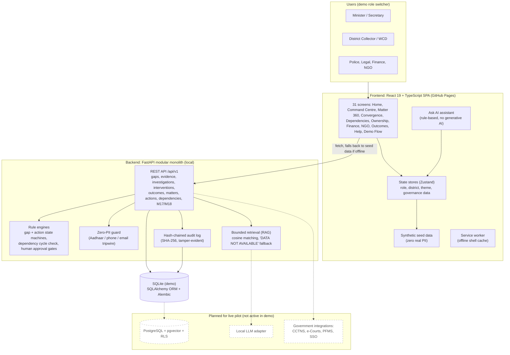

# WCD Protection Intelligence Platform (Suraksha Sentinel & Sahyog)

AI-assisted Government Protection, Policy, Service Delivery, Convergence and Accountability Platform for the **Ministry of Women & Child Development (MoWCD), Government of India**.

**Navigation:** [1. Project Overview](#1-project-overview) · [2. Structure by Features](#2-structure-by-features) · [3. Architecture & Repository Structure](#3-architecture--repository-structure) · [4. Documentation Index](#4-documentation-index) · [5. Quickstart](#5-local-development-quickstart)

---

## 1. Project Overview

### The Problem
India's WCD ecosystem (Mission Shakti, Mission Vatsalya, POSHAN 2.0) already operates large MIS portals, yet protection fails between institutions:
1. **Institutional Silos:** A survivor interacts with 6–12 disconnected authorities (OSC, Police, Hospital, DLSA, Shelter, CWC) with no shared continuity or SLA accountability.
2. **Process ≠ Outcome:** Referrals can complete on paper while survivors return to unsafe environments due to missing legal aid, shelter, or economic support.
3. **Action Gap:** Senior officials have aggregate statistics, not an investigation mechanism linking **observed failure → verified evidence → named owner → corrective action → measured 90-day outcome**.

### How This Platform Solves It
The platform runs a **Twin-Domain + Shared Intelligence** architecture across the lifecycle:
`DISCOVER → INVESTIGATE → VALIDATE → ASSIGN → ACT → VERIFY → LEARN`

* **Domain A — Women Protection Intelligence (Active Demo / MVP):** Covers `Safety → Support → Legal → Shelter → Economic/Livelihood → Rehabilitation` (`W01–W12`), proving end-to-end protection gap resolution.
* **Domain B — Child Protection Intelligence (Phase 2/3 Architecture-Ready):** Covers `C01–C16` (POCSO, JJ Act, CWC, CCI, aftercare) as aggregate research and taxonomy only in MVP; live child case workflows remain locked (`403`) behind separate statutory approvals.
* **Shared Protection & Execution Layer:** Command Centre, Matter 360°, Convergence & Dependency 360°, RACI Ownership, Financial Intelligence, NGO & Community Collaboration, Police & Litigation Coordination, Evidence Library, Gap Contracts, Investigation Workspace, Bounded AI (`temperature=0.0` with `"DATA NOT AVAILABLE"` fallback), Intervention Approval, Outcome Verification, Immutable SHA-256 Audit Chain, 19-Step End-to-End Demo (`/demo-flow`), and Help & Platform Knowledge Centre (`/help`).
* **Non-Negotiable Guardrails:** Zero PII in central/AI storage (HMAC-SHA256 tokens), no individual risk scoring, no AI judicial/fact findings, no public district leaderboards, and mandatory human validation/approval gates. See [`AGENTS.md`](./AGENTS.md).

---

## 2. Structure by Features

```
WCD Protection Intelligence Platform
├── Domain A: Women Protection (MVP Active)          ──> /women
├── Domain B: Child Protection (Phase 2 Locked 403)    ──> /child
├── Executive & Role Workspaces
│   ├── Home Governance Hub & Role Dashboards          ──> /, /command-centre, /dashboards
│   ├── My Work & Alerts Escalation                    ──> /my-work, /alerts, /attention
│   └── 19-Step End-to-End Demo & Help Knowledge Hub   ──> /demo-flow, /help
├── Coordination, Convergence & Finance
│   ├── Matter 360° (Police, Litigation, Welfare)      ──> /matter-360
│   ├── Convergence Graph & Dependency 360°            ──> /convergence, /dependencies
│   ├── RACI Ownership & Financial Execution           ──> /ownership, /finance
│   └── NGO & Community Collaboration                  ──> /ngo-community
└── Shared Protection Intelligence & Governance
    ├── Evidence Library & Gap Explorer                ──> /evidence, /gaps
    ├── Investigation & Problem Decomposition          ──> /investigation, /decompose
    ├── Interventions, Outcomes & Excellence             ──> /interventions, /outcomes, /excellence
    ├── AI Intelligence & Statutory RAG Assistant      ──> /ai-intelligence, /knowledge-assistant
    └── WORM Audit & Explainability                    ──> /audit, /governance
```

| Feature Module | Purpose | Route | Demo Status |
|---|---|---|---|
| **Home & Command Centre** | Executive situational clarity, role-based dashboards (Minister, Secretary, Collector, Finance), and attention queue | `/`, `/command-centre`, `/dashboards` | Available (Synthetic Demo) |
| **Women Protection Workspace** | Domain A 6-stage continuum (`Safety → Rehabilitation`) & M18 continuity tracker | `/women` | Available (Synthetic Demo) |
| **Child Protection Preview** | Domain B research taxonomy (`C01–C16`) & JJ Act / POCSO blueprint (live child PII locked `403`) | `/child` | Architecture-Ready (Locked) |
| **Matter 360°** | Unified workspace across Overview, Police, Litigation, Court Orders, Welfare, Finance, Ownership & NGO | `/matter-360` | Available (Synthetic Demo) |
| **Convergence & Dependency 360°** | Inter-departmental links, 17 dependency types, cycle detection, and lawful-wait distinction | `/convergence`, `/dependencies` | Available (Synthetic Demo) |
| **Ownership & Financial Execution** | Role-attached RACI matrix, transfer history, and `Allocated → Sanctioned → Released → Utilised` tracking | `/ownership`, `/finance` | Available (Synthetic Demo) |
| **NGO & Community Collaboration** | Empaneled NGOs, Local Bodies/SHGs, approved activities, and zero auto-PII boundary | `/ngo-community` | Available (Synthetic Demo) |
| **Evidence, Gaps & Investigation** | Source provenance, 11-type Gap Contracts, competing hypotheses, and Problem Decomposition | `/evidence`, `/gaps`, `/investigation`, `/decompose` | Available (Synthetic Demo) |
| **Interventions, Outcomes & Excellence** | Human-approved corrective actions, 90-day outcome verification, and quality-gated recognition | `/interventions`, `/outcomes`, `/excellence` | Available (Synthetic Demo) |
| **AI Intelligence & RAG Assistant** | Bounded AI findings (`temperature=0.0`), limitations, and `"DATA NOT AVAILABLE"` fallback | `/ai-intelligence`, `/knowledge-assistant` | Available (Synthetic Demo) |
| **19-Step End-to-End Demo** | Interactive walkthrough of a full multi-department case lifecycle from intake to verified outcome | `/demo-flow` | Available (Synthetic Demo) |
| **Help & Platform Knowledge Centre** | 30-category interactive orientation hub, local search, role/department/issue guides, mindmap, FAQs & glossary | `/help` | Available |
| **Audit & Governance** | Tamper-evident SHA-256 WORM ledger, Zero-PII `422` guard, and explainability controls | `/audit`, `/governance` | Available (Synthetic Demo) |

### Implementation Status (Done vs Post-Demo Production Pending)

| Category | Done (Verified Demo Prototype) | Pending (Live Government Pilot Only) |
|---|---|---|
| **Frontend Application** | React 19 + TypeScript SPA, Civic Intelligence Light + Pink & Black/White high-contrast themes, compact icon-only header, bottom-docked `Ask AI` assistant, 31 routes (responsive `375px` to `1920px+`), `Help & Knowledge Centre`, `19-Step Demo`, M17/M18 simulators, offline PWA service worker & sync queue, `10/10` Vitest passing, `21/21` Playwright screenshots (`31` routes × `4` viewports, `0` errors, `0` overflows) | Live field sync against production NIC MeghRaj endpoint |
| **Backend & Intelligence** | FastAPI modular monolith, SQLAlchemy ORM + Alembic (`0001` & `0002` with PostgreSQL RLS DDL), deterministic Gap & 12-state Action machines, M17/M18 DB APIs, `PgVectorAdapter` & `LocalLLMAdapter` scaffolds, `/integrations/status` registry, Zero-PII `422` guard, DB-backed SHA-256 WORM audit chain (`28/28` Pytest passing) | Managed PostgreSQL + `pgvector` on NIC MeghRaj, local quantised LLM weights, live CCTNS/ICJS/PFMS APIs |
| **Governance & Security** | Explicit CORS origins, signed Bearer JWT, Domain B (`CHILD`) `403` write lock, prompt-injection refusal, mandatory human approval gates | External Gov SSO IdP, VAPT (`G09`), `G03` WCD/Police protocol, `G04` DPDP opinion, `G10` paper baseline |

---

## 3. Architecture & Repository Structure

### Architecture Diagram

Demo architecture: a static React app that works fully on its own with synthetic data, and optionally talks to a local FastAPI service. Dashed boxes are planned for a live pilot and are **not active** in the demo.



**Request flow:** screen → state store → (optional) REST call → Zero-PII check → rule engine / human-approval gate → database write → audit-log entry. If the backend is unreachable the app switches to synthetic seed data and shows a "Demo mode" banner.

**Design rules:** AI never approves, validates or certifies. Child protection (Domain B) is read-only (`403` on writes). All data is synthetic.

### Repository Structure

```
women-child-protection-agent/
├── README.md                    # Master platform overview, structure & quickstart
├── AGENTS.md                    # System invariants, domain boundaries & safety rules
├── DESIGN.md                    # Civic Intelligence Light & B/W theme tokens and WCAG contrast
├── HELP_CONTENT_INDEX.md        # Help & Platform Knowledge Centre structure & maintenance index
├── SCREENSHOT_INDEX.md          # 21-screen Playwright capture index & responsive verification log
├── src/                         # Frontend React 19 + TypeScript + Tailwind SPA
├── backend/                     # Python FastAPI modular monolith, services, ORM & tests
├── scripts/                     # Automated Playwright verification & screenshot capture scripts
└── docs/                        # Audit-ready requirements, architecture, AI safety & execution docs
```

---

## 4. Documentation Index

| Document | Scope |
|---|---|
| [`DESIGN.md`](./DESIGN.md) | Civic Intelligence Light & Black/White colour tokens, WCAG 2.1 AA focus & contrast verification |
| [`AGENTS.md`](./AGENTS.md) | Non-negotiable system invariants, Zero-PII rules, Domain A/B isolation & human gates |
| [`HELP_CONTENT_INDEX.md`](./HELP_CONTENT_INDEX.md) | 30-category Help & Platform Knowledge Centre architecture and route-integrity coverage |
| [`SCREENSHOT_INDEX.md`](./SCREENSHOT_INDEX.md) | 21-screen Playwright visual & responsive (`1280px` / `768px` / `375px`) verification index |
| [`docs/00-BUSINESS_REQUIREMENT.md`](./docs/00-BUSINESS_REQUIREMENT.md) | Origin proposal, Protection Chain Intelligence & 16-step build sequence |
| [`docs/01-BUSINESS_REQUIREMENTS.md`](./docs/01-BUSINESS_REQUIREMENTS.md) | Canonical BRD v3.0: problem framing, domains, M01–M20 catalogue, FR/NFRs, G01–G10 gates, KPIs |
| [`docs/02-ARCHITECTURE_AND_PLAN.md`](./docs/02-ARCHITECTURE_AND_PLAN.md) | Modular monolith architecture, PWDVA/JJ/POCSO DAGs, core schema & execution plan |
| [`docs/03-AI_SAFETY_AND_GOVERNANCE.md`](./docs/03-AI_SAFETY_AND_GOVERNANCE.md) | Golden invariant, prohibited AI decisions, epistemic tags, bounded A1–A4 AI & VAPT benchmarks |
| [`docs/04-DATA_GOVERNANCE_AND_SECURITY.md`](./docs/04-DATA_GOVERNANCE_AND_SECURITY.md) | Zero-PII HMAC tokenization, DPDP 2023 / JJ Act s.74 / POCSO s.23 / PWDVA s.12 controls, RLS |
| [`docs/05-AUDIT_AND_TRACEABILITY.md`](./docs/05-AUDIT_AND_TRACEABILITY.md) | Verified codebase audit, traceability matrix, acceptance criteria & pilot readiness gates |
| [`docs/06-EXECUTION_PLAN.md`](./docs/06-EXECUTION_PLAN.md) | Phased engineering milestones (A–I) and post-demo production roadmap |
| [`docs/07-ENHANCEMENT_AUDIT_AND_ROADMAP.md`](./docs/07-ENHANCEMENT_AUDIT_AND_ROADMAP.md) | Governance, Matter 360°, Convergence, Finance & NGO integration feasibility matrix |

---

## 5. Local Development Quickstart

### Frontend
```bash
npm install
npm run dev        # Start Vite dev server (http://localhost:5173)
npm test           # Run Vitest suite (10/10 tests)
npm run build      # Type-check and production build
```

### Backend
Run from the repository root:
```bash
python3 -m venv backend/.venv
source backend/.venv/bin/activate
pip install -r backend/requirements.txt
uvicorn backend.app.main:app --reload --port 8000
```
API docs available at `http://127.0.0.1:8000/api/v1/docs` and health check at `http://127.0.0.1:8000/health`.
